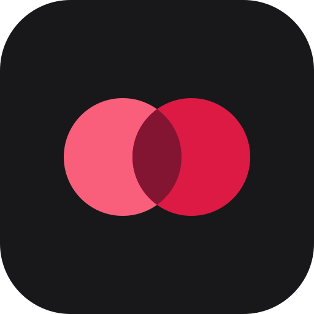
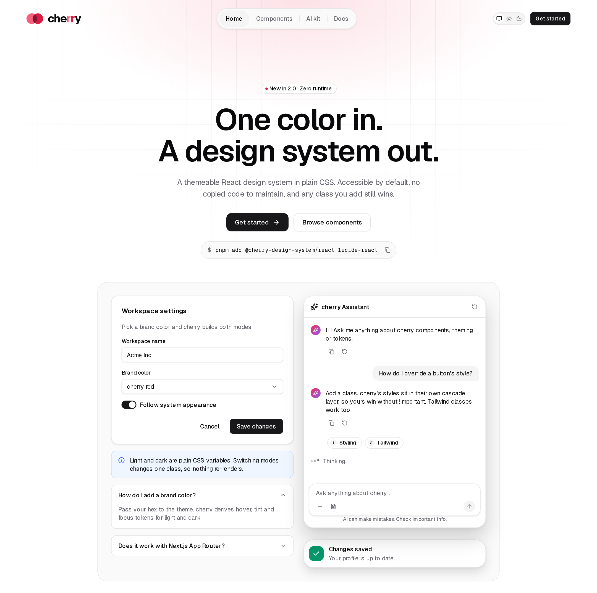
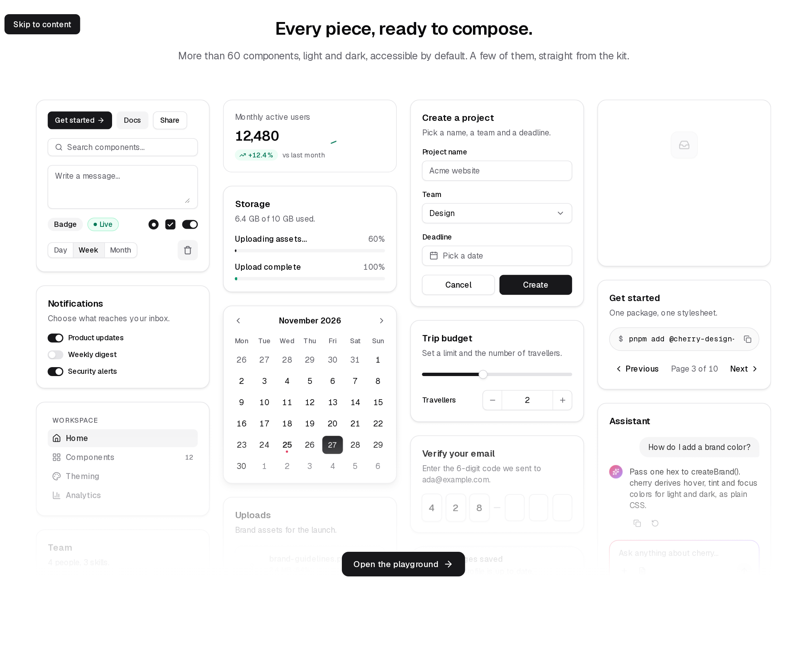

<div align="center">
  <a href="https://cherry.al/">
    <picture>
      <source media="(prefers-color-scheme: dark)" srcset=".github/assets/cherry-mark-dark.svg" />
      
    </picture>
  </a>

  <h1>cherry.al</h1>

  <p><strong>One color in. A design system out.</strong></p>

  <p>
    The website for <a href="https://github.com/cherry-design-system/react">cherry 2.0</a>, a themeable React design system in plain CSS.<br />
    Every component on the page is the real <code>@cherry-design-system/react</code> package, not a screenshot.
  </p>

  <p>
    <a href="https://www.npmjs.com/package/@cherry-design-system/react"></a>
    
    
  </p>

  <p>
    <a href="https://cherry.al/">Website</a> ·
    <a href="#develop">Develop</a> ·
    <a href="#whats-inside">What's inside</a> ·
    <a href="#seo-and-ai-discoverability">SEO</a> ·
    <a href="#analytics">Analytics</a> ·
    <a href="https://github.com/cherry-design-system/react">Library</a>
  </p>
</div>

<p align="center">
  <picture>
    <source media="(prefers-color-scheme: dark)" srcset=".github/assets/hero-dark.png" />
    
  </picture>
</p>

## Develop

```bash
pnpm install
pnpm dev     # http://localhost:3000
pnpm build   # production build, every route prerendered
pnpm lint
```

Copy [`.env.example`](./.env.example) to `.env.local` to set the site URL, the PostHog key, or extra dev origins (a Tailscale URL, for example).

## What's inside

| Path                              | What                                                                                   |
| --------------------------------- | -------------------------------------------------------------------------------------- |
| `app/page.tsx`                    | The landing page, composed from `components/landing/*`.                                |
| `components/landing/ProductShot`  | Live preview: settings form, callout, FAQ and a working assistant chat.                |
| `components/landing/Showcase`     | The bento of 30+ real components, interactive, in light and dark.                      |
| `lib/site.ts`                     | Name, URLs and copy shared by the page, metadata and structured data. Edit links here. |
| `lib/content.ts`                  | Features and FAQ, used by both the page and its JSON-LD so they never drift.           |
| `.agents/skills/cherry-react`     | The cherry agent skill: components, props and tokens for coding agents.               |

The page follows the cherry 2.0 Figma kit. Styling is plain CSS Modules on `--cherry-*` tokens, so light, dark and system modes come for free, and cherry's own rules stay in `@layer cherry` underneath.

<p align="center">
  <picture>
    <source media="(prefers-color-scheme: dark)" srcset=".github/assets/showcase-dark.png" />
    
  </picture>
</p>

## SEO and AI discoverability

- **Metadata.** Canonical URL, title template, Open Graph, Twitter cards and Google snippet settings in `app/layout.tsx`.
- **Brand assets from Figma.** The OG image, favicon, apple icon, Android icons and a maskable icon are exported from the kit's Assets page.
- **Crawlers.** `robots.txt` allows search engines and AI crawlers (GPTBot, ClaudeBot, PerplexityBot and more) by name, plus `sitemap.xml` and a web manifest.
- **For agents.** [`/llms.txt`](https://cherry.al/llms.txt) and [`/llms-full.txt`](https://cherry.al/llms-full.txt) describe cherry in Markdown for tools that don't run JavaScript.
- **Structured data.** Organization, WebSite, SoftwareApplication and FAQPage JSON-LD, server-rendered from `lib/seo/schemas.ts`.

## Analytics

PostHog loads from `instrumentation-client.ts` through a first-party `/ingest` proxy, so ad blockers don't drop events. By default it keeps nothing in cookies or storage, so the site needs no cookie banner. Nothing loads at all without `NEXT_PUBLIC_POSTHOG_KEY`.

Set `NEXT_PUBLIC_POSTHOG_COOKIELESS=true` once cookieless mode is on in the PostHog project, for stable visitor counts.

## Security

Every route sends `X-Content-Type-Options`, `X-Frame-Options`, `Referrer-Policy`, `Permissions-Policy` and HSTS headers (`next.config.ts`). The only inline scripts are cherry's static theme script and escaped JSON-LD.

Report vulnerabilities in cherry itself through the [library's Security tab](https://github.com/cherry-design-system/react/security).

## License

[MIT](https://github.com/cherry-design-system/react/blob/main/LICENSE)
